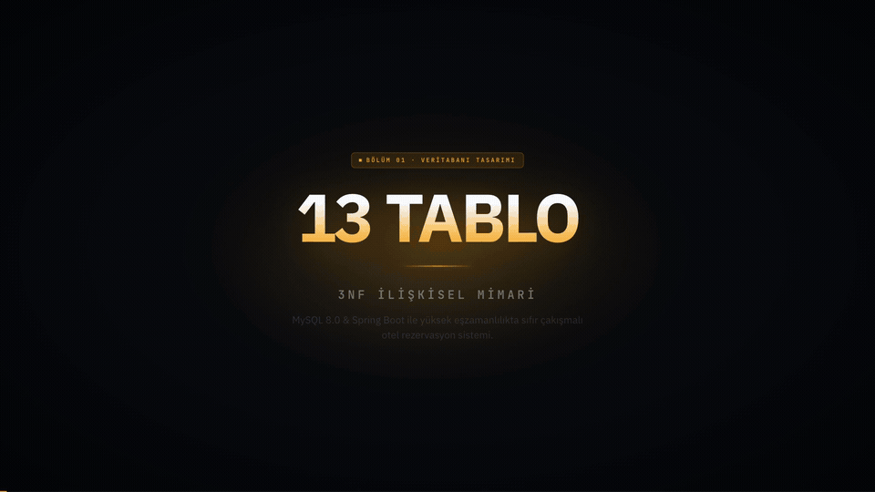

# remotion-lab

`remotion-lab`, Markdown betiklerinden (`edge-tts` + `WordBoundary`) veya harici ses kayıtlarından (`faster-whisper`) kelime zaman damgalı transkripsiyon üreten ve JSON tabanlı sahne tanımları (`TimelineSpec`) üzerinden 1080p 30 FPS teknik proje sunumları derleyen veri güdümlü (data-driven) bir Remotion video motorudur.



---

## Mimari Tasarım (Motor vs. Veri Ayrımı)

Motor katmanı ile içerik/veri katmanı kesin sınırlarla ayrılmıştır. Yeni bir video veya bölüm üretmek için çekirdek React/Remotion bileşenlerine, tema sabitlerine veya `Root.tsx` kompozisyon kayıtlarına dokunmak gerekmez; tüm sahne akışı `src/data/` altındaki JSON sözleşmesi (`TimelineSpec`) üzerinden sürülür.

```text
+-----------------------------------------------------------------------------+
|  SES VE PLANLAMA HATTI (scripts/ · Python .venv + ffmpeg + edge-tts/whisper)|
|                                                                             |
|  [A] src/data/script.md -> generate_voice.py (edge-tts + WordBoundary)      |
|          + pronunciation.json  -> public/audio/kayit.wav + transcript.json  |
|  [B] public/audio/*.mp3 -> enhance_audio.py -> transcribe.py (whisper)      |
|                                                                             |
|  pipeline.py (`npm run produce`): voice -> plan_timeline.py -> typecheck    |
+-------------------------------------+---------------------------------------+
                                      |
                                      v
+-----------------------------------------------------------------------------+
|  VERI VE ICERIK KATMANI (Degistirilebilir Katman)                           |
|                                                                             |
|  src/data/script.md & pronunciation.json -> Metin betigi ve TTS okunuslari  |
|  src/data/timeline.json                  -> MainVideo kompozisyonu          |
|  src/data/chapters/*.json                -> ChaptersVideo + Chapter-*       |
|  src/data/chapters_draft/*.json          -> Onay oncesi otomatik taslaklar  |
|  src/data/examples/*.json                -> Vitrin ve bilesen testleri      |
|  public/{audio,media,sfx}/               -> Statik ses, gorsel ve SFX       |
+-------------------------------------+---------------------------------------+
                                      |
                                      |  Discriminated Union (TimelineSpec)
                                      v
+-----------------------------------------------------------------------------+
|  KILITLI CEKIRDEK MOTOR KATMANI (Salt Okunur Uretim Siniri)                 |
|                                                                             |
|  src/theme.ts            Tek dogruluk kaynagi (renk, font, 30 FPS, MOTION)  |
|  src/engine/                                                                |
|    ├── types.ts          TimelineSpec, TimelineBeat, SfxKey, SceneTransition|
|    ├── chapters.ts       require.context ile alfabetik bolum birlestirici   |
|    └── TimelineRenderer  PersistentBackgroundLayer, HUD, FilmGrain, SFX     |
|  src/backgrounds/        Kayit defteri: obsidianGrid, dotMatrix, radialGlow |
|  src/components/         Kayit defteri: 10 moduler gorsel bilesen           |
|  src/Root.tsx            Otomatik MainVideo, ChaptersVideo, Chapter-* kaydi |
+-----------------------------------------------------------------------------+
```

---

## Bileşen Havuzu ve Tasarım Kısıtlamaları

### Görsel İmza ve Mühendislik Standartları

- **30 FPS ve FPS-Bağımsız Zamanlama:** Varsayılan kompozisyon `1920x1080 @ 30 FPS` olarak sabitlenmiştir (düşük RAM tüketimi ve Apple Silicon üzerinde ~2x hızlı render). Tüm bileşen içi gecikmeler ham kare sayısı yerine `secToFrames(seconds, fps)` fonksiyonuyla hesaplanır.
- **Yay Fiziği (Spring Motion):** Doğrusal (`linear`) giriş animasyonları yasaktır; tüm hareketler `src/theme.ts` içindeki üç profille (`MOTION.snap`, `MOTION.editorial`, `MOTION.impact`) yönetilir.
- **Renk Disiplini:** Yüzeyin `%92`'si monokrom Obsidian (`#07090d` / `#040609`) ve gümüş-beyaz tipografiden (`#e6edf3` / `#94a3b8`) oluşur. Tek imza vurgu rengi Sıcak Mühendislik Kehribarı (`#f59e0b`) olup, semantik kırmızı (`#f87171`) ve yeşil (`#34d399`) yalnızca diff, karşılaştırma ve HTTP durum kodlarında kullanılır.
- **Geometri, Doku ve Sıfır Sıçrama:** Keskin `12px`/`8px` köşe yarıçapları, `1px solid rgba(255,255,255,0.08)` kenarlıklar, CAD köşe nişangâhları (`CadCorners`), global `%2.5` monokrom film greni (`FilmGrainOverlay`) ve `EngineeringHUD` kullanılır. Kademeli açılan bloklar ilk kareden itibaren DOM'da rezerve edilir (zero layout shift).
- **3–5 Saniye Tempo Kuralı:** Hiçbir sahne (`beat`) 5.0 saniyeyi aşmaz; geliştirme önizlemesinde aşım tespit edilirse otomatik uyarı rozeti gösterilir.

### Kayıtlı Görsel Modüller (`src/components/index.ts`)

| Bileşen | Rol ve Teknik Özellikler |
| :--- | :--- |
| `HighlighterText` | Kartsız (`frameless`) veya kartlı tipografi; kelime zaman damgalı `highlightAtSecs` kehribar vurgu bandı. |
| `GlassCard` | Bulanık cam yüzeyli odak kartı (`blur(12px)`), `CadCorners`, `SpecularSweep` ve anahtar-değer listesi. |
| `NodeFlow` | 2 veya 3 düğümlü mimari akış diyagramı; FPS-bağımsız `DashedConnector` Bezier okları ve kehribar veri paketi darbesi. |
| `StepCard` | Kademeli aktif adım vurgulu sıralı süreç ve mimari özet listesi. |
| `CodeWindow` | Karanlık macOS kod penceresi (`sql`, `java`, `bash`); çok adımlı `focusSteps`, Git/SQL `diffLines` ve `embedded` modu. |
| `ComparisonCard` | İki sütunlu karşılaştırma kartı; sol sütun semantik hata/eski yaklaşım, sağ sütun 3NF/doğru mimari. |
| `MediaWindow` | Görsel, GIF ve `<OffthreadVideo />` MP4 çerçevesi; `zoomPan` yakınlaşması ve otomatik arka plan `blur(6px)`. |
| `MetricBanner` | Tam ekran bölüm geçişi ve kritik metrik vuruşu; HUD gizlenir, varsayılan olarak `thud` SFX tetikler. |
| `SplitStage` | 60/40 (veya `reverse` ile 40/60) asimetrik sahne; gömülü kod/medya/terminal penceresi ile canlı hero metrik (`before -> value`). |
| `TerminalTrace` | Sıfır düzen sıçramalı canlı `curl` yazımı, istek gövdesi, HTTP durum kodu (`201 Created` / `409 Conflict`) ve renklendirilmiş JSON yanıt akışı. |

---

## Kurulum ve Çalıştırma Akışı

### Gereksinimler

- Node.js 20+ ve npm
- Python 3.11+
- Sistem PATH üzerinde `ffmpeg` ve `ffprobe`

### 1. Bağımlılıkların Kurulumu

```bash
npm install

python3 -m venv .venv
.venv/bin/pip install edge-tts faster-whisper numpy pillow
```

### 2. Yerel Ses Efektleri ve Ambiyans Üretimi

Büyük ses/video dosyaları `.gitignore` ile depo dışında tutulduğundan ilk kurulumda prosedürel SFX (`whoosh`, `pop`, `tick`, `thud`) ve arka plan ambiyansı yerel olarak üretilir:

```bash
.venv/bin/python scripts/generate_sfx.py
.venv/bin/python scripts/generate_ambient.py
```

### 3. Tek Komutluk Otomatik Üretim (`script.md` + `edge-tts`)

Anlatım metnini `## Bölüm 1: ...` başlıklarıyla `src/data/script.md` dosyasına yazdıktan sonra ücretsiz `edge-tts` sentezini, `WordBoundary` kelime zaman damgalarını (%0 Whisper ASR hatası), 3–5 sn bölüm taslaklarını (`src/data/chapters_draft/`) ve TypeScript doğrulamasını tek komutta çalıştırabilirsin:

```bash
# Tam taslak boru hatti: generate_voice.py -> plan_timeline.py (--split-by-script) -> typecheck
npm run produce

# Ozel betik, farkli ses (ornegin tr-TR-EmelNeural) veya konusma hizi ile:
npm run produce -- src/data/script.md --voice tr-TR-AhmetNeural --rate +4%

# Yalnizca ses (kayit.wav) ve WordBoundary transcript.json uretmek icin:
npm run voice -- src/data/script.md --speak-headings
```

Teknik terimlerin Türkçe seslendirmede doğal okunması `src/data/pronunciation.json` üzerinden yönetilir; ekranda ve `transcript.json` içinde daima orijinal temiz yazımlar (`MySQL 8.0`, `3NF`, `@Transactional`, `Foreign Key`, `GitHub`) korunur.

### 4. Harici Ses Kaydından Üretim (Mikrofon / ElevenLabs)

Dışarıdan hazır ses kaydını `public/audio/` klasörüne yerleştirdiğinde klasik akış aynen çalışır:

```bash
# 2-pass -14 LUFS ses iyilestirme + duraksama kesici -> public/audio/kayit_temiz.wav
npm run enhance

# Kelime/cumle zaman damgali Turkce transkripsiyon -> src/data/transcript.json
npm run transcribe
# Belirli bir ses dosyasi icin:
# .venv/bin/python scripts/transcribe.py public/audio/kayit.wav

# Sozluk duzeltmeli (glossary.json) 3-5 sn taslak uretimi -> src/data/timeline_draft.json
npm run plan

# Uzun videolari ~60 sn bolum taslaklarina ayirma (audioOffsetSec otomatik eklenir)
.venv/bin/python scripts/plan_timeline.py --split-chapters 60 --chapters-dir src/data/chapters_draft
```

### 5. Doğrulama, Önizleme ve Render

```bash
# Zorunlu TypeScript ve JSON sozlesme kontrolu
npm run typecheck

# Remotion Studio canli onizleme
npm run dev

# Tekil timeline.json render -> out/video.mp4
npm run build

# Tekil bolum render (M1/dusuk RAM icin onerilen)
npm run build:chapter -- Chapter-01-giris out/bolum_01.mp4

# src/data/chapters/*.json birlesik tam render -> out/chapters.mp4
npm run build:chapters
```

---

## AI-Assisted Spec-Driven Workflow

Bu depo, kök dizindeki [`GEMINI.md`](GEMINI.md) dosyasında tanımlanan bağlayıcı mimari anayasa altında yapay zekâ ajan orkestrasyonu ile geliştirilmiş ve işletilmektedir. Bu iş akışı üretim kalitesini deterministik kurallarla güvence altına alır:

- **Kilitli Çekirdek Sınırı:** İçerik üretim görevlerinde ajanların `src/theme.ts`, `src/engine/`, `src/components/`, `src/backgrounds/` ve `src/Root.tsx` dosyalarına müdahalesi engellenir; yalnızca `src/data/` ve `public/` katmanı güncellenir.
- **Taslak Öncelikli Güncelleme ve Sözlük Öğrenimi:** Otomatik planlayıcı doğrudan üretim zaman çizelgesini ezmez; yeni tespit edilen teknik terim veya Whisper telaffuz kaymaları `src/data/glossary.json` dosyasına eklenerek sonraki videolarda kalıcı olarak düzeltilir.
- **Doğrulama Kapıları:** Her değişiklik `npm run typecheck` (`tsc --noEmit`), 3–5 saniye tempo denetimi ve `ffmpeg` kare çıkarımı üzerinden görsel kalite kontrolünden geçirilir.
